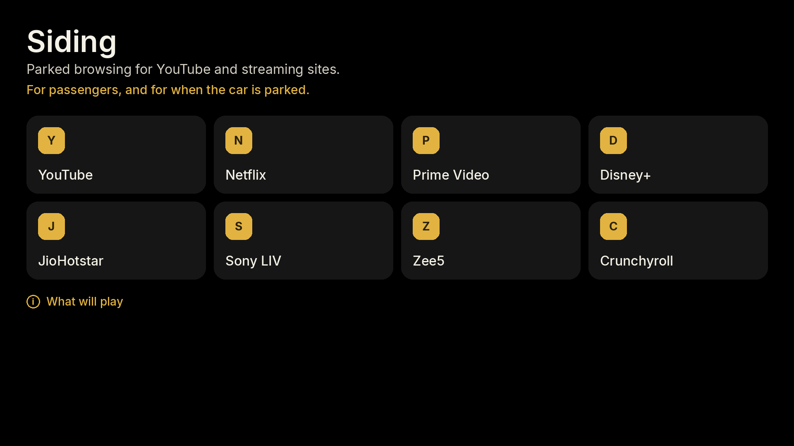
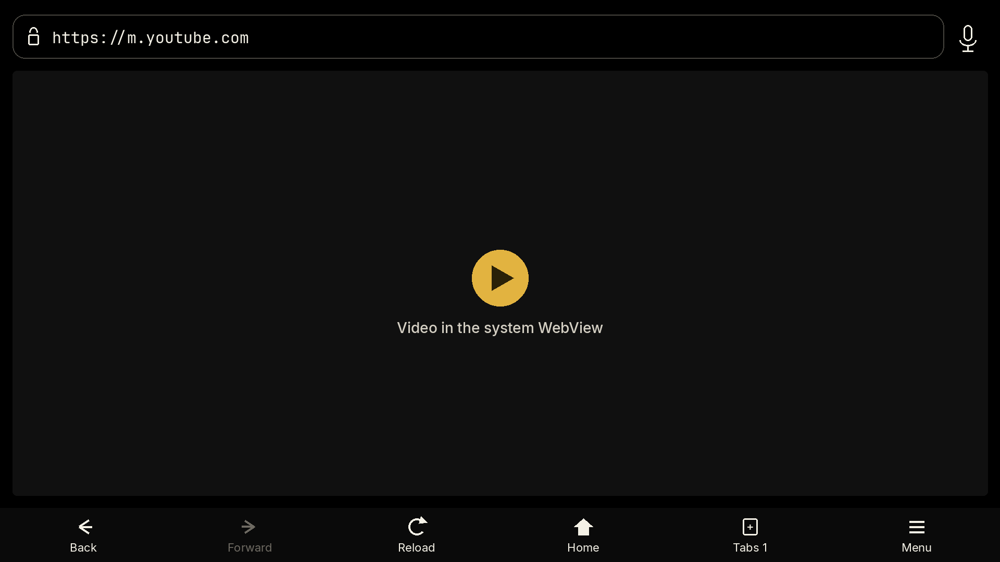
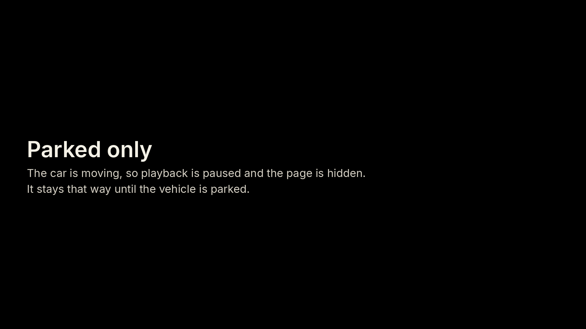

# Siding

Siding is a parked browser for a phone or a car screen. The shelf opens YouTube, Netflix, Prime Video, Disney+, JioHotstar, Sony LIV, Zee5, and Crunchyroll. Any other `http` or `https` site can be typed, spoken, or shared in. Playback uses the system WebView, including its normal Widevine support, and it stops when the app is paused or the car reports driving restrictions.

**[Download Siding 1.0.0 (APK)](https://github.com/ratheshr8/android-auto-stream/releases/download/v1.0.0/Siding-1.0.0.apk)** · [Release notes](https://github.com/ratheshr8/android-auto-stream/releases/tag/v1.0.0) · Apache-2.0

| | |
| --- | --- |
| Package | `app.siding.browser` |
| Version | 1.0.0 (versionCode 1) |
| Android | 10 and newer (API 29), target API 35 |
| ABIs | `arm64-v8a`, `armeabi-v7a`, `x86`, `x86_64` |
| APK SHA-256 | `f92de1ee2f1bc85529fad299d89c4504a72e87fb60971f6b0136a05da0cac224` |
| Signer certificate SHA-256 | `3d2167cb1bc639ab2569b8e55e098479f06a4c01c88a3963361aa98fa9870736` |

The figures below are drawn from the true-black theme. They are not photographs of a phone or a head unit, and the player is a placeholder rather than a capture of a streaming site.



The shelf. Long-press a shortcut in the app to rename it or point it somewhere else.



Address bar, system WebView, and the bottom bar. Forward stays dim until there is a page to return to.



What the car screen shows while driving restrictions are on.

## Install

The APK is the signed 1.0.0 release, about 40 MB. It is not listed on the Play Store.

1. Download [Siding-1.0.0.apk](https://github.com/ratheshr8/android-auto-stream/releases/download/v1.0.0/Siding-1.0.0.apk) on the phone, or copy it across.
2. Confirm the file before you install it:

   ```bash
   sha256sum Siding-1.0.0.apk
   ```

   The digest must be `f92de1ee2f1bc85529fad299d89c4504a72e87fb60971f6b0136a05da0cac224`.
3. Open the file. When Android asks, allow that app (Chrome, Files, or Drive) to install unknown apps. You need Android 10 or newer.
4. Open **Siding** from the phone launcher. On Android Automotive OS it is also a car-launcher browser, and the system is expected to keep it parked-only.

Sign in on each service yourself. Clear cookies from Settings before someone else uses the car. A later build signed with a different key will not install over this one; uninstall Siding first in that case.

## What it includes

| | |
| --- | --- |
| Shelf | Eight shortcuts. Edit or clear any of them |
| Pages | Address bar, Google / DuckDuckGo / Bing search, spoken search, back, forward, reload, home, find on page, share |
| Tabs | Up to eight. Bookmarks and the last 50 history entries |
| Layout | Display scale from 80% to 150%. Light, dark, and true black. Optional page darkening |
| Desktop sites | Removes only the `Mobile` token. The WebView `wv` token stays |
| Media | Fullscreen video, downloads into the public Downloads folder, file upload |
| Permissions | Microphone, camera, and location are asked per site. Protected media is allowed so a page can try normal DRM |
| Sign-in | Cookies stay on the device. Password and payment autofill are off. Backup is off |
| Startup | Shelf, a home page, or the last tabs |

Incoming links work too: open an `http` or `https` URL with Siding, or share a block of text and Siding will take the first URL in it.

## What will play

YouTube’s mobile site often plays. Netflix, Prime Video, Disney+, JioHotstar, Sony LIV, Zee5, Crunchyroll, and similar services often refuse a WebView, ask for their own app, or require hardware DRM (Widevine L1). The system WebView usually has software DRM (L3) only. The page decides. Siding does not strip the WebView identity, does not impersonate a TV or another browser, and does not rewrite DRM robustness.

Names of those services belong to their owners. The shelf is only a shortcut to their sites.

## Phone, Android Auto, and Android Automotive

Google’s current parked-app rules:

- Browsers are a beta category on Android Automotive OS, and they are not a supported Android Auto category
- Video apps are for Android Automotive OS, not for phone-projected Android Auto
- Games are the only parked category Android Auto lists, and only while parked

Siding declares `APP_BROWSER` and `CAR_LAUNCHER`. It does not set `distractionOptimized`, and it does not declare itself as a game, a map, or a navigation app. On Android Automotive OS the system is expected to block the activity while the car is moving. On phone Android Auto, a browser may not appear in the launcher at all. That is a platform limit, not a switch in Settings.

While restrictions are on, Siding pauses every page, mutes media, and hides the WebView behind the parked screen. A headset or media-button play request is ignored in that state. The app does not read vehicle speed or gear, and it does not try to stay on the head unit while driving.

`android.hardware.type.automotive` is optional, so the same APK installs on a normal phone. Camera, microphone, location, Wi-Fi, portrait, and landscape are optional too.

## Build from source

Requirements: JDK 17 or newer, and Android SDK 35.

```bash
# local.properties
sdk.dir=/path/to/android-sdk

./gradlew :app:assembleDebug
./gradlew :app:testDebugUnitTest
```

Install `app/build/outputs/apk/debug/app-debug.apk` for day-to-day work.

The downloadable file is a release build. Release signing stays out of the repository. Set these in the environment and Gradle will sign `app/build/outputs/apk/release/app-release.apk`. Without them, `assembleRelease` writes an unsigned APK.

```bash
export SIDING_STORE_FILE=/path/to/siding-release.jks
export SIDING_STORE_PASSWORD=...
export SIDING_KEY_ALIAS=siding
export SIDING_KEY_PASSWORD=...
./gradlew :app:assembleRelease
```

Do not commit the keystore or those passwords. `*.jks`, `*.keystore`, and `*.apk` are gitignored.

## Safety

Siding is for passengers and for parked time. If you are driving, leave it closed. Pages only load over `http` and `https` (and `localhost` for development). `javascript:`, `intent:`, `file:`, and `data:` navigations are blocked. Certificate errors cancel the load. Non-http downloads are refused.

## License

[Apache License 2.0](LICENSE). Copyright 2026 Siding contributors.

## Author

Rathesh R — [ratheshworld.com](https://ratheshworld.com) · [github.com/ratheshr8](https://github.com/ratheshr8)
